<h1 align="center">
  
</h1>

  

### 👩‍💻 About Me

- 🎓 B.Tech CSE student
- 💻 Passionate about **Python** and **SQL**
- 📊 Learning **Data Engineering**
- 🚀 Building, learning and growing every day

### 🛠️ Skills

  
  
  
  
  
  
  

### 📊 GitHub Stats

  
  

  

  
  

  

